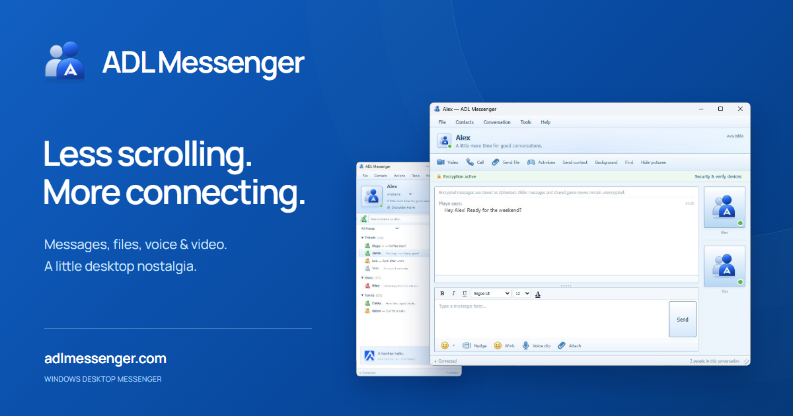
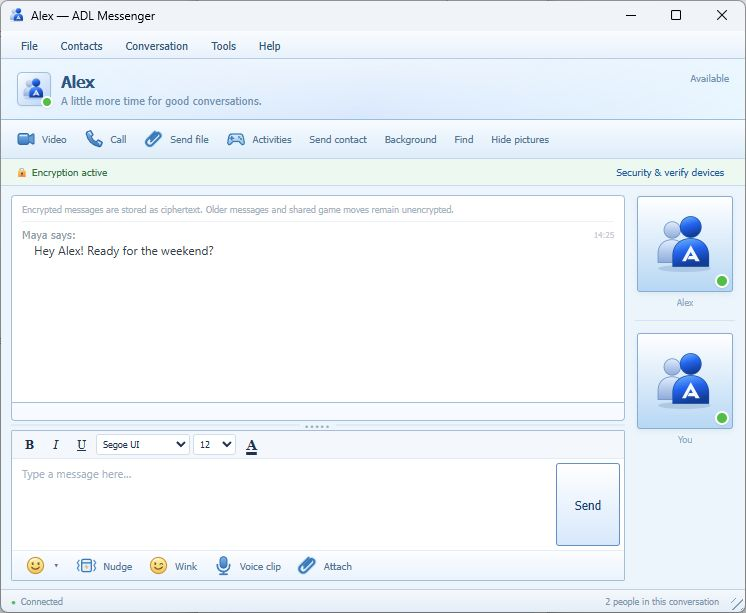
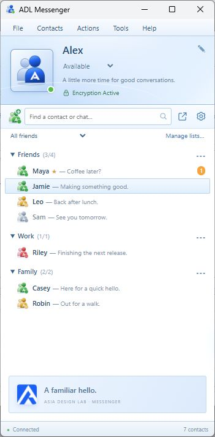

# ADL Messenger

**Miss MSN Messenger or Windows Live Messenger?** ADL Messenger is a retro rebuild of the classic Windows desktop chat experience by **ASIA DESIGN LAB**.

**[Download the signed Windows installer](https://github.com/AsiaDesignLab/adl-messenger/releases/download/v0.5.35/ADL-Messenger-Setup-0.5.35.exe)** · [Release notes and checksum](https://github.com/AsiaDesignLab/adl-messenger/releases/tag/v0.5.35) · [Product website](https://www.adlmessenger.com/)

## The retro rebuild

See who’s online in a compact contact list, set a personal status message, and open separate chat windows for your conversations. Emoticons, winks, and nudges are back. New chats and shared files are encrypted, and you can make one-to-one voice and video calls.

## Install on Windows

1. Download **ADL-Messenger-Setup-0.5.35.exe** for 64-bit Windows from the release assets.
2. Run the installer and follow the setup prompts. This version is a free Windows release candidate.
3. Open ADL Messenger and sign in with your ADL account, or create an account and verify your email.

You can check the installer’s signature on the **Digital Signatures** tab in Windows file properties. You can also compare its SHA-256 hash with [SHA256SUMS.txt](https://github.com/AsiaDesignLab/adl-messenger/releases/download/v0.5.35/SHA256SUMS.txt).

## Try it

<table>
  <tr>
    <td width="50%" valign="top">
      <strong>Start a conversation</strong> 
       
      Open a contact, type a message, and select <strong>Send</strong>. Use <strong>Send file</strong> to share a document or picture.
    </td>
    <td width="50%" valign="top">
      <strong>Organize your contacts</strong> 
       
      Add someone to your contacts and use private lists to keep friends, family, or coworkers together.
    </td>
  </tr>
</table>

To make a one-to-one call, open a conversation with another ADL Messenger user and choose **Call** or **Video**. Windows may ask for microphone or camera access.

The screenshots use demonstration accounts from an earlier Windows release.

## Other downloads and help

- [Android beta](https://adlsoftware.net/downloads/adl-messenger-android/)
- [Official downloads and version history](https://www.adlmessenger.com/#versions)
- [Frequently asked questions](https://www.adlmessenger.com/#questions)
- [Terms](https://www.adlmessenger.com/legal/terms/) · [Software licence](https://www.adlmessenger.com/legal/software-license/) · [Privacy policy](https://www.adlmessenger.com/legal/privacy/)

[Explore more software from ASIA DESIGN LAB](https://www.adlsoftware.net/)
